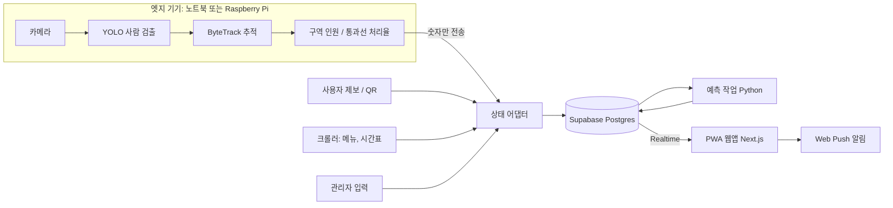

# ERICA 캠퍼스 대기 통합 서비스 준비계획서 (개정 2판)

> Kiro 참고용 원문. 규칙은 `.kiro/steering/`, 기능별 요구사항은 `docs/briefs/`가 우선한다.

AI+X 공학융합프로젝트 2026 가을, 팀 굳건 (team09)

세탁실, 오픈스페이스, 셔틀, 학식, 주차장. 줄이 생기는 곳을 한 앱에서 보고, 카메라로 줄 길이를 세어 예상 대기시간을 알려주는 프로토타입을 이번 학기 안에 완주하기 위한 계획입니다.

- **다섯 기능을 '대기 자원' 하나로 모델링합니다.** 세탁기, 오픈스페이스, 셔틀 정류장, 식당, 주차장은 모두 상태와 대기열을 가진 자원입니다. 공통 모델 위에 데이터 공급원(영상, 제보, 크롤러, 관리자 입력)만 갈아 끼우는 구조로 갑니다.
- **AI+X의 중심은 영상 인원 계수와 대기시간 추정입니다.** 줄 인원만 세지 않고 배식구·탑승구의 분당 처리 인원을 함께 재서 "지금 서면 몇 분 기다리나"를 계산합니다. 셔틀과 학식이 같은 비전 모듈을 공유하므로 한 번 만들어 두 기능에 씁니다.
- **영상은 저장하지 않고 숫자만 내보냅니다.** 통계값 산출을 위한 일시적 처리는 법적 예외가 있지만, 설치 허가와 저장 금지가 전제입니다. 개발은 공개 데이터셋, 데모는 동의받은 연출 영상과 라이브 웹캠, 현장 파일럿은 허가받은 한 곳만 합니다.
- **병목은 코딩이 아니라 허가와 데이터입니다.** 학교 부서 문의(카메라 설치 허가 포함)와 교수님 확인을 이번 주에 시작해야 4주차 범위 확정에 반영됩니다. 허가가 안 나와도 데모가 완결되도록 대안 경로를 명세 단계부터 넣습니다.

## 기능별 데이터 확보 전략

각 기능이 "무엇으로 상태를 알아내는가"가 설계의 출발점입니다. 1순위가 막혀도 일정이 멈추지 않게 대안을 같이 정합니다.

| 기능 | 1순위 데이터 소스 | 협조가 필요한 곳 | 막혔을 때 대안 | 학기 목표 |
| --- | --- | --- | --- | --- |
| 학식·푸드코트 혼잡도 | 줄 구역 영상 인원 계수 + 배식구 통과 인원(처리율)으로 예상 대기시간 산출, 메뉴는 크롤링 | 식당 운영 부서, 시설 관리 부서 (카메라 설치 허가) | 연출 영상·웹캠 라이브 데모, 사용자 혼잡도 제보, 시간대 예측값 | Must |
| 셔틀 대기줄 | 정류장 줄 영상 인원 계수 + 공개 시간표 + 버스 정원으로 "몇 대 뒤 탑승" 계산 | 시설 관리 부서 (야외 설치 허가), 시간표는 공개 자료 | 정류장별 줄 길이 제보, 과거 제보 기반 예측 | Must |
| 기숙사 세탁·건조 | 기기별 QR 스캔으로 사용 시작·코스 입력, 타이머로 종료 예측, 가상 대기열 | 창의인재원 행정실 (QR 부착 허가) | QR 없이 앱에서 기기 번호 선택 | Must |
| 오픈스페이스 | 입구 QR 체크인·체크아웃으로 재실 인원 집계 | 단과대 행정팀 (QR 부착, 기존 예약 시스템 확인) | 조교 수동 입력 화면 + 목업 데이터 | Should |
| 주차장 잔여석 | 주차관제 시스템의 입출차 집계 | 총무·시설 담당 부서 | 관리자 입력 + 목업 데이터로 화면만 구현 | Could |

세탁기 진동 센서는 영상 파이프라인과 엣지 기기 작업이 겹치므로 Could로 내렸습니다. 여유가 생기면 같은 Raspberry Pi에 붙여 시도합니다.

### 이미 있는 서비스와의 차별점

학생이 만든 '하냥냥'이 학식 메뉴, 셔틀·대중교통 시간표와 도착정보, 도서관 좌석 등을 탭별로 제공하고 있습니다. 우리는 정보 나열이 아니라 "지금 가면 몇 분 기다리나"(영상 기반 추정)와 "내 차례가 되면 알려준다"(가상 대기열)로 차별화합니다. 3주차 경쟁 분석에 반드시 포함하세요.

## 영상 기반 혼잡도 측정

이 프로젝트의 AI 요소입니다. 기술보다 "어디서, 누구를 찍느냐"가 난이도를 좌우하므로 세 단계로 나눕니다.

**1단계** (Must)

### 개발과 정확도 평가: 공개 데이터셋

MOT17·MOT20(보행자 추적), CrowdHuman(밀집 인원 검출), Mall 데이터셋(인원 계수)으로 모델을 고르고 오차를 측정합니다. 실제 학생이 찍히지 않으므로 법적 부담이 없고, 10주차 테스트의 기준 데이터가 됩니다.

**2단계** (Must)

### 데모: 동의받은 연출 영상과 라이브 웹캠

빈 강의실에서 팀원과 동의서를 쓴 지인들이 줄을 서고, 노트북 카메라가 인원과 처리율을 세서 대시보드의 예상 대기시간이 실시간으로 바뀌는 장면을 만듭니다. 튜닝용 녹화도 이 연출 영상으로만 합니다.

**3단계** (Should)

### 현장 파일럿: 허가받은 한 곳만

시설 부서 허가와 안내문 게시가 확보되면 학식 한 코너처럼 실내 한 곳에서 짧게 운영합니다. 영상은 저장하지 않습니다. 허가가 안 나오면 1·2단계만으로 프로토타입이 완결됩니다.

### 처리 파이프라인

1. **프레임 입력** 노트북 웹캠 또는 Raspberry Pi 카메라에서 2~5초마다 한 장을 메모리로 읽습니다. 디스크에 쓰지 않습니다.
2. **사람 검출** YOLO 경량(nano급) 모델로 사람 박스를 찾습니다. 줄이 빽빽한 곳은 머리 검출 모델과 비교 실험합니다.
3. **대기 구역 판정** 줄 영역을 다각형으로 지정하고 발 위치가 그 안에 있는 사람만 셉니다. 가림으로 숫자가 튀므로 10초 이동 중앙값으로 평활화합니다.
4. **처리율 측정** ByteTrack으로 사람을 추적하고, 배식구·탑승구에 그은 통과선을 넘는 인원을 분당으로 셉니다.
5. **대기시간 계산** 예상 대기 = 줄 인원 ÷ 분당 처리 인원. 셔틀은 버스 정원과 다음 출발 시각을 더해 "몇 대 뒤에 탑승 가능"을 계산합니다.
6. **숫자만 전송** 서버에는 자원 ID, 인원, 처리율, 예상 대기, 신뢰도, 시각만 보내고 프레임은 즉시 폐기합니다.

**인원 수와 대기시간은 다릅니다.** 학식 줄 30명이라도 배식이 빠르면 5분이고, 셔틀 줄 30명이라도 버스 정원이 차면 다음 차를 기다려야 합니다. 처리율과 정원을 함께 쓰는 것이 이 서비스를 단순 인원 카운터와 구별하는 지점이고, 발표에서 가장 강조할 내용입니다.

### 정확도 목표와 한계

- 공개 데이터셋과 연출 영상에서 줄 인원 평균 절대 오차 2명 이하, 예상 대기시간 오차 2분 이하를 목표로 합니다. 수치는 4주차에 팀이 확정합니다.
- 밀집·가림이 심한 곳은 전신 검출이 약합니다. 카메라를 높이 달아 위에서 내려다보게 하면 개선되고 식별 가능성도 낮아집니다.
- 셔틀콕은 야외라 역광·야간·비에 약합니다. 실내인 학식을 먼저 하고 셔틀은 연출 데모와 제보로 시작합니다.
- Ultralytics YOLO는 AGPL-3.0 라이선스입니다. README에 출처와 라이선스를 명시합니다.

## 이번 학기 범위 (MoSCoW)

4주차 요구 명세의 기준입니다. Won't로 빼는 이유는 ETHICS.md에도 남깁니다.

### Must 데모에서 반드시 동작

- 통합 대시보드: 자원별 현재 상태와 예상 대기시간
- 영상 인원 계수 + 처리율 기반 대기시간 추정 (연출 영상·라이브 웹캠)
- 학식 메뉴와 혼잡도, 셔틀 다음 출발과 줄 길이
- 세탁기 사용 표시, 남은 시간, 가상 대기열, 내 차례 알림
- 영상 불가 시 제보·예측값으로 대체 표시

### Should 가능하면 포함

- 학식 한 곳 현장 파일럿 (허가 시)
- 셔틀 "몇 대 뒤 탑승" 계산
- 시간대별 혼잡도 예측 모델
- 오픈스페이스 QR 체크인
- 검출 모델 비교 실험 (전신 vs 머리)

### Could 여유 있을 때

- 주차장 잔여석 (관리자 입력·목업)
- 세탁기 진동 센서
- 영어 UI, 관리자 자원 등록 화면

### Won't 이번 학기 제외

- 현장 영상 저장, 클라우드 비전 AI로 프레임 전송
- 얼굴 인식 등 개인 식별, 성별·연령 추정
- 허가 없는 카메라 설치, 사용자 GPS 수집
- 강제력 있는 세탁기 예약, 학번 로그인, 결제

**세탁기는 예약 대신 가상 대기열입니다.** 앱을 안 쓰는 학생이 먼저 쓰면 예약은 바로 깨집니다. "순번 등록 → 기기가 비면 1순위에게 알림 → 5분 안에 사용 시작이 없으면 다음 순번"은 실물 우선 원칙과 충돌하지 않습니다.

## 아키텍처와 기술 스택

영상은 엣지 기기 안에서 끝나고, 서버는 숫자만 받습니다. 7주차 아키텍처 활동지의 초안입니다.



### 권장 스택

| 영역 | 선택 | 이유 | 대안 |
| --- | --- | --- | --- |
| 비전 | Python, OpenCV, Ultralytics YOLO (nano), ByteTrack, Roboflow supervision | 구역 인원·통과선 계수 도구가 갖춰져 있어 파이프라인을 빨리 조립 | OpenVINO·ONNX 변환으로 Pi 속도 개선 |
| 엣지 기기 | 노트북 웹캠 (기본), Raspberry Pi 5 + 카메라 모듈 (파일럿) | 2~5초 간격 계수라 저사양으로도 충분 | 학과 실습실 Jetson 보드 대여 |
| 클라이언트 | Next.js PWA | 앱스토어 없이 배포, 홈 화면 추가 시 푸시, 에이전트가 잘 다루는 스택 | React + Vite |
| 백엔드·DB | Supabase (Postgres, Realtime, Edge Functions) | 실시간 반영이 핵심인데 구독 기능이 기본 제공 | FastAPI + PostgreSQL + WebSocket |
| 예측·크롤링 | pandas, scikit-learn, GitHub Actions 스케줄 실행 | 서버 없이 주기 실행 후 결과를 DB에 기록 | Supabase cron |
| 배포·협업 | Vercel, GitHub Issues·Projects, Figma | PR마다 미리보기 배포, 이력을 저장소에 모음 | Notion 병행 |

### 핵심 데이터 모델

```
resources       (id, kind[laundry|space|shuttle|cafeteria|parking], zone, name, capacity, source)
vision_metrics  (id, resource_id, people_count, throughput_per_min, est_wait_min, confidence, device_id, created_at)
status_events   (id, resource_id, state, occupancy_level, source[vision|report|admin|crawl], created_at)
queue_tickets   (id, resource_id, device_id, position, status[waiting|called|done|expired], called_at)
reports         (id, resource_id, level[1-5], device_hash, created_at, expires_at)
predictions     (resource_id, weekday, time_slot, predicted_level, model_version)
edge_devices    (id, resource_id, api_key_hash, last_seen_at)
push_subs       (device_id, endpoint, keys, created_at)
```

사용자는 학번 대신 익명 기기 ID로 식별합니다. vision\_metrics에는 이미지나 좌표 목록이 들어갈 칸 자체가 없습니다. 저장 금지를 스키마 수준에서 강제하는 셈입니다.

## 요구 명세 예시 (EARS)

4주차 활동지를 이 형식으로 채우고, 10주차에는 문장마다 테스트를 하나 이상 연결합니다.

- REQ-VIS-01 · 상시엣지 모듈은 카메라 프레임을 디스크에 기록하거나 네트워크로 전송하지 않아야 한다.
- REQ-VIS-02 · 이벤트WHEN 대기 구역 인원이 갱신되면, 시스템은 인원을 분당 처리 인원으로 나눈 예상 대기시간을 10초 이내에 대시보드에 반영해야 한다.
- REQ-VIS-03 · 조건IF 검출 신뢰도가 기준값 미만이거나 엣지 기기 신호가 60초 이상 끊기면, THEN 시스템은 제보·예측값으로 대체하고 그 사실을 표시해야 한다.
- REQ-VIS-04 · 상시시스템은 평가용 영상 세트에서 줄 인원의 평균 절대 오차를 2명 이하로 유지해야 한다.
- REQ-SHT-03 · 이벤트WHEN 사용자가 정류장을 선택하면, 시스템은 줄 인원과 버스 정원으로 계산한 탑승 가능 회차를 표시해야 한다.
- REQ-LAU-04 · 이벤트WHEN 대기열이 있는 세탁기가 '사용 가능'으로 바뀌면, 시스템은 1순위 대기자에게 5초 이내에 푸시 알림을 보내야 한다.
- REQ-LAU-05 · 조건IF 호출된 대기자가 5분 안에 사용을 시작하지 않으면, THEN 시스템은 해당 순번을 만료하고 다음 대기자를 호출해야 한다.
- REQ-RPT-01 · 조건IF 한 기기가 같은 자원에 10분 안에 두 번째 제보를 보내면, THEN 시스템은 제보를 거부하고 재제보 가능 시각을 안내해야 한다.
- REQ-SYS-01 · 상시시스템은 사용자의 학번, 이름, 위치 좌표를 저장하지 않아야 한다.

## 역할 분담 (4인)

각자 **가로 역할 하나** (품질 책임)와 **세로 기능 하나** (화면부터 DB까지 끝까지 책임)를 맡습니다. 이름 배정은 첫 회의에서 각자 경험을 보고 정합니다.

### PM · 명세 리드

- EARS 요구 명세, 백로그·마일스톤
- 학교 부서·교수님 연락 창구, 촬영 동의서 관리
- 결과보고서 편집, ETHICS.md
- 세로 기능: 오픈스페이스·주차

### 프론트엔드 리드

- PWA 화면, 대기시간 시각화, 접근성
- Web Push 구독 흐름
- 시연 영상 제작
- 세로 기능: 셔틀 대기줄 화면과 탑승 회차 계산

### 백엔드 · 인프라 리드

- DB 스키마, 행 단위 보안(RLS), API
- 엣지 기기 인증과 배포, CI, 재현성 문서
- 세탁기 진동 센서 (Could)
- 세로 기능: 세탁실 대기열

### 비전 · AI 리드

- 영상 파이프라인, 모델 선정과 정확도 평가
- 처리율·대기시간 계산, 혼잡도 예측
- 크롤러
- 세로 기능: 학식 혼잡도

비전 작업이 가장 무거우므로 9~10주차에는 백엔드 리드가 엣지-서버 연결을 함께 맡아 부담을 나눕니다. 돌아가며 맡는 역할: 주간 PR 리뷰 담당 1명, PROMPTS.md 정리 담당 1명.

## 학기 로드맵

날짜는 9월 1일 개강 기준 추정입니다. 수업 주제는 강의계획을 따르고, 각 주 활동지가 결과보고서의 한 절이 됩니다.

### 1–2주차: 패러다임, Context Engineering
9/1 ~ 9/11 완료

- 팀 구성, 템플릿 저장소 생성

### 3주차: 도메인 문제 발굴 (기획)
9/14 ~ 9/18 · 지금

- 설문(목표 50명)과 인터뷰 5명: 가장 괴로운 대기 순위, 영상 측정에 대한 인식
- 현장 관찰: 학식 점심 피크, 셔틀콕 등교 시간의 줄 인원과 분당 처리 인원을 손으로 기록 (정확도 비교의 기준값)
- 학교 부서 문의 메일 발송 (카메라 설치 가능 여부 포함)
- 교수님께 로컬 영상 추론이 과목 AI 사용 규칙에 맞는지 확인
- 하냥냥 등 경쟁 분석

### 4주차: 요구 명세와 EARS (기획)
9/21 ~ 9/25 · 추석 연휴(9/24~26) 주의

- MoSCoW와 Won't 목록 확정, 정확도 목표 수치 확정
- REQ-VIS 계열 포함 기능별 EARS 작성
- 연휴 전으로 회의 당기기

### 5주차: 계획과 태스크 분해 (기획)
9/28 ~ 10/2

- 요구사항을 GitHub Issue로 분해, 9~13주차 마일스톤 배정
- 비전 기술 검증: 공개 데이터셋에서 YOLO nano 기준 오차 측정 (반나절짜리 실험)
- Raspberry Pi·카메라 대여 또는 주문, 현장 관찰 주 2회 지속

### 6주차: Version Control과 에이전트 워크플로 (설계)
10/5 ~ 10/9 · 10/5 대체공휴일, 10/9 한글날

- 브랜치 전략, PR 템플릿, CI(린트·테스트) 구성
- Next.js·Supabase·vision 폴더 뼈대, 미리보기 배포 연결
- 촬영 동의서 확정, 연출 영상 1차 촬영

### 7주차: 아키텍처와 컨텍스트 설계 (설계)
10/12 ~ 10/16

- ADR 작성: 엣지 추론 vs 서버 추론, 프레임 비저장 설계
- DB 스키마, API, 엣지 기기 인증 방식 확정
- 에이전트 컨텍스트 파일에 "프레임 저장 코드 금지" 같은 규칙 명시
- Figma 와이어프레임, 메뉴 크롤러 가동

### 8주차: 중간고사
10/19 ~ 10/23

- 개발은 쉬고 크롤러만 유지, 5주차 실험 결과 정리

### 9주차: 구현 착수 (구현)
10/26 ~ 10/30

- 수직 슬라이스 1: 웹캠 → 인원 계수 → DB → 대시보드 숫자 변경
- 공통 자원 모델, 세탁실 QR 흐름 착수

### 10주차: 검증 Ⅰ: 테스트 (구현)
11/2 ~ 11/6

- 정확도 테스트: 공개 데이터셋과 연출 영상에서 REQ-VIS-04 검증 자동화
- 처리율·대기시간 계산, 대기열 호출·만료 단위 테스트
- 셔틀·학식 화면과 제보 대체 경로 구현

### 11주차: 중간 데모와 리뷰 병목 (구현)
11/9 ~ 11/13

- 라이브 웹캠 계수가 포함된 MVP로 중간 데모
- 기숙사생 5~10명 베타 테스트, 피드백 이슈화

### 12주차: 검증 Ⅱ: 보안과 품질 (구현)
11/16 ~ 11/20

- 프레임 비저장 검증: 파일 쓰기·네트워크 전송 감사, 엣지 API 키 보호
- RLS 점검, 제보 스팸 방지, 의존성 취약점 점검
- 검출 모델 비교 실험, 허가 시 학식 현장 파일럿

### 13주차: 거버넌스와 재현성 (구현)
11/23 ~ 11/27

- 모델 가중치 버전 고정, 라이선스 표기, Pi 설치 스크립트, .env.example, 시드 데이터
- 오픈스페이스·주차 어댑터, 기능 동결
- 연출 영상 보관 기한 확인과 삭제 계획 기록

### 14주차: 최종 데모데이 (마무리)
11/30 ~ 12/4

- 라이브 계수 시연: 촬영 구역을 바닥 테이프로 한정하고 안내문 게시, 참여는 자원자만
- 3분 시연 영상, 발표자료, 리허설 2회, 담당 코드 설명 연습

### 15주차: 회고와 기말 제출 (마무리)
12/7 ~ 12/11

- 활동지를 엮어 결과보고서 완성 (정확도 평가 결과 포함), README·PROMPTS.md 정리
- 개인 성찰문, 윤리 노트 6편 재검토, 연출 영상 삭제

## 준비 체크리스트

체크 상태는 이 브라우저에만 저장됩니다.

### 이번 주 (4주차 수업 전까지)

- [ ] 킥오프 회의: 역할, 정기 회의 시간, 소통 채널 확정
- [ ] 학교 부서 문의 메일 발송: 기숙사(QR), 단과대(오픈스페이스), 식당 운영·시설 관리(카메라), 주차 관리
- [ ] 교수님께 로컬 영상 추론과 연출 촬영이 과목 규칙에 맞는지 확인
- [ ] 설문 배포 (대기 빈도, 가장 괴로운 대기, 카메라 기반 측정 수용도, 알림 선호)
- [ ] 현장 관찰 1회차: 요일, 시각, 줄 인원, 분당 처리 인원 기록
- [ ] 경쟁 서비스 분석표, week-03 활동지 작성, 윤리 노트 개인 제출

### 구현 전 (7주차까지)

- [ ] GitHub Projects 보드, 이슈·PR 템플릿, 라벨 체계
- [ ] Supabase, Vercel 팀 계정 (비밀키는 저장소 밖에서 공유)
- [ ] 공개 데이터셋 다운로드와 각 데이터셋 이용 조건 확인
- [ ] 촬영 동의서 양식 (목적, 저장 여부, 보관 기한, 철회 방법)
- [ ] 엣지 기기 확보: 학과 장비 대여 먼저 확인, 없으면 Raspberry Pi 5와 카메라 모듈 구매
- [ ] 크롤링 대상 페이지의 robots.txt와 이용 조건 확인
- [ ] README, PROMPTS.md, ETHICS.md, 에이전트 컨텍스트 파일 초안

### 저장소 구조 제안

```
aix-2026f-team09/
├── docs/            # week-XX 활동지, ADR, 회의록, 정확도 평가 결과
├── specs/           # EARS 요구사항 (기능별 파일)
├── apps/web/        # Next.js PWA
├── supabase/        # 마이그레이션, RLS 정책, 시드
├── vision/          # 엣지 파이프라인 (검출, 추적, 구역·통과선 설정)
│   └── eval/        # 데이터셋 평가 스크립트 (영상 파일은 커밋 금지)
├── jobs/            # 크롤러, 예측 모델
├── tests/           # 인수 테스트 (REQ ID와 1:1)
├── README.md  PROMPTS.md  ETHICS.md  CLAUDE.md
```

`.gitignore`에 영상 확장자(\*.mp4, \*.avi, \*.jpg 등)를 넣어 실수로라도 영상이 저장소에 올라가지 않게 합니다.

## 협업 규칙

- **브랜치:** `main` 보호, 작업 브랜치 이름에 요구사항 ID를 넣습니다. 예: `feat/REQ-VIS-02-wait-time`
- **PR:** 400줄 이하, 리뷰어 1명 승인 필수. 본문에 관련 REQ ID, 테스트 방법, 사용한 에이전트 프롬프트 요약을 적습니다. vision 폴더 변경은 "프레임이 저장·전송되지 않는가"를 체크 항목으로 둡니다.
- **에이전트 사용:** 주요 판단과 프롬프트를 PROMPTS.md에 기록합니다. 설명하지 못하는 코드는 머지하지 않습니다.
- **데이터:** 현장 영상과 연출 영상 프레임은 어떤 AI 도구에도 넣지 않습니다. 에이전트에게는 코드와 숫자 결과만 보여줍니다. 설문 원본의 응답자 정보도 마찬가지입니다.
- **회의:** 주 1회 정기 회의(30분), 수업 직후 10분 점검. 결정은 docs/meetings에 남깁니다.
- **막힘 규칙:** 혼자 2시간 이상 막히면 팀 채널에 공유합니다.

## 윤리와 법 (ETHICS.md 후보)

- **영상 처리의 법적 근거:** 공개된 장소의 고정형 카메라는 원칙적으로 설치가 제한되지만, 개인정보 보호법 시행령 제22조는 출입자 수 같은 통계값 산출을 위해 영상을 일시적으로 처리하는 경우를 예외로 둡니다. 우리 설계는 이 예외에 맞추되, 시설 관리 권한자의 허가와 안내문 게시를 전제로 하고, 위반 시 과태료가 있으므로 현장 설치 전에 세부 의무를 다시 확인합니다.
- **저장하지 않음:** 현장 프레임은 메모리에서만 처리하고 폐기합니다. 튜닝이 필요하면 동의받은 연출 영상만 사용하고, 보관 기한이 지나면 삭제합니다.
- **식별하지 않음:** 얼굴 인식, 개인 재식별, 성별·연령 추정은 하지 않습니다. 추적 ID는 처리율 계산에만 쓰고 저장하지 않습니다.
- **동의:** 연출 촬영 참여자는 목적, 보관 기한, 철회 방법이 적힌 동의서를 씁니다. 데모데이 라이브 시연은 촬영 구역을 한정하고 자원자만 들어오게 합니다.
- **위치정보:** 사용자 GPS를 쓰지 않고 정류장을 직접 선택하게 합니다.
- **공정성:** 세탁기는 실물 우선 원칙을 명시하고 앱은 안내 도구로 둡니다.
- **제보 조작:** 빈도 제한, 제보 만료, 영상 수치와 크게 어긋나는 제보의 가중치 하향으로 대응합니다.
- **이해관계자:** 촬영될 수 있는 학생, 식당 직원, 시설 관리 부서, 앱 비사용 학생, 유학생을 영향 대상으로 정리합니다.

## 리스크와 대응

| 리스크 | 가능성 | 대응 |
| --- | --- | --- |
| 카메라 설치 허가 불가 | 높음 | 공개 데이터셋 평가와 연출·라이브 데모만으로 완결되게 설계, 현장은 Should로 유지 |
| 교수님이 영상 처리에 제한을 둠 | 중간 | 3주차에 확인, 제한 시 공개 데이터셋만으로 평가하고 데모는 공개 영상 재생으로 대체 |
| 밀집·가림으로 오차 증가 | 중간 | 높은 설치 각도, 머리 검출 모델 비교, 평활화, 신뢰도 낮으면 제보·예측으로 대체 |
| Raspberry Pi 추론 속도 부족 | 중간 | 계수 간격 늘리기, 모델 경량 변환, 데모는 노트북으로 |
| 범위 과다로 전부 미완성 | 중간 | 9주차 수직 슬라이스 1개 우선, 13주차 기능 동결, 세탁 센서는 Could 유지 |
| 제보 참여 저조 | 높음 | 영상 수치와 팀 관찰 데이터로 기본값을 채우고 제보는 보조로 |
| iOS 푸시 제약 | 중간 | 홈 화면 추가 안내, 실패 시 화면 내 배너 |
| 라이선스 미표기 | 낮음 | 의존성 라이선스 표를 README에 두고 PR 체크 항목에 포함 |

## 제출물 8종 매핑

| 제출물 | 언제부터 쌓나 | 담당 |
| --- | --- | --- |
| 저장소 URL | 6주차 구성 완료 | 백엔드·인프라 |
| 실행 가능한 결과물 | 9주차부터 미리보기 배포, 엣지 모듈 실행 가이드 포함 | 전원 |
| 시연 영상 (3분) | 11주차 중간 데모 녹화를 초안으로, 등장인물은 동의자만 | 프론트엔드 |
| README.md | 6주차 초안, 13주차 재현성·라이선스 보강 | 백엔드·인프라 |
| PROMPTS.md | 지금부터 매주 | 순번 담당 |
| 결과보고서 | 매주 활동지 한 절씩, 10·12주차 정확도 평가 결과 포함 | PM |
| 발표자료 | 11주차 중간 데모 자료 확장 | PM + 비전·AI |
| 개인 성찰문 | 윤리 노트와 주간 회고 메모 | 각자 |

팀 굳건 (박재원, 박지성, 강태혁, 전시준) 준비계획서 개정 2판 · 2026년 9월 16일. 학교 부서명, 셔틀 운영 방침, 학사 일정, 영상정보 관련 세부 의무는 공식 자료로 재확인이 필요합니다.
